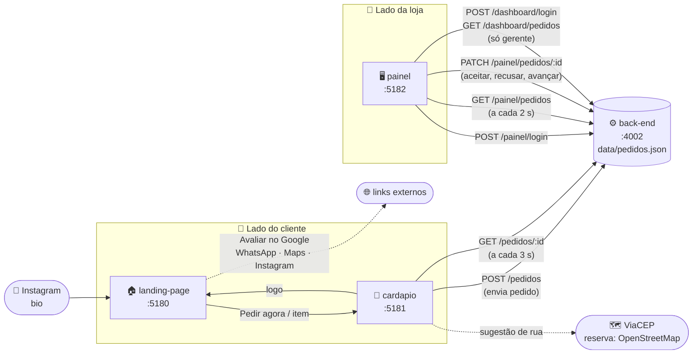
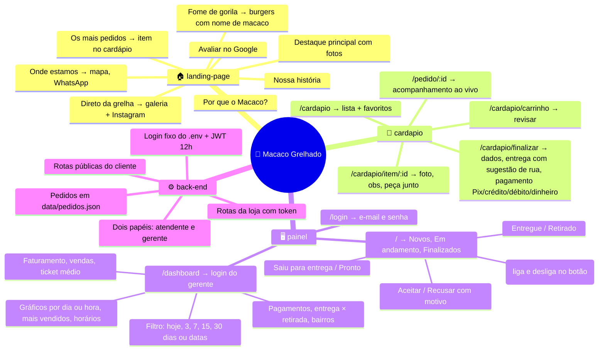
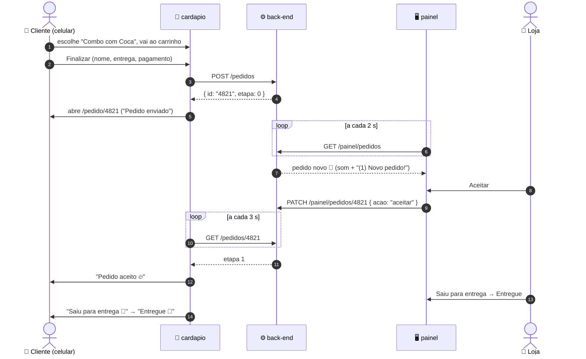
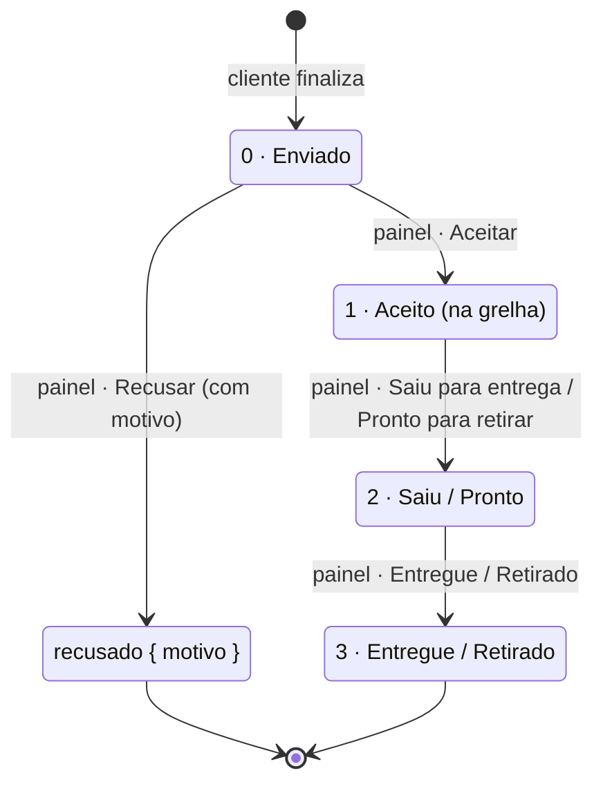
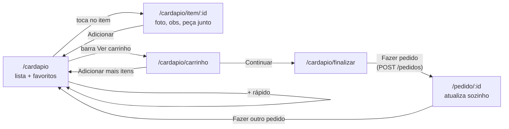

# 🐒 Macaco Grelhado · Mapa do projeto

O "mapa mental" do projeto: **quem fala com quem**, **para onde cada rota leva** e **o que cada arquivo faz**.
Leia isto antes de mexer em qualquer coisa. O resumo da ideia e do status está em [RESUMO.md](RESUMO.md), e o prompt para continuar com outro Claude está em [PROMPT-claude-code.md](PROMPT-claude-code.md).

> Os diagramas abaixo usam **Mermaid**. Eles aparecem desenhados no GitHub e no VS Code (com a extensão "Markdown Preview Mermaid Support").

---

## 1. Visão geral: as 4 peças



| Peça | Pasta | Porta | Para quem | O que faz |
|---|---|---|---|---|
| Landing | `landing-page/` | 5180 | Cliente | Apresenta a loja e leva para o cardápio |
| Cardápio | `cardapio/` | 5181 | Cliente | Monta o pedido, envia e acompanha |
| Painel | `painel/` | 5182 | Loja (com login) | Recebe e gerencia os pedidos · `/dashboard` com login próprio do gerente |
| Back-end | `back-end/` | 4002 | Os dois | Guarda os pedidos e faz o login da loja |

---

## 2. Mapa mental



---

## 3. A jornada de um pedido



### Etapas do pedido (campo `etapa`)



O back-end **não deixa pular etapas**: não dá para avançar um pedido sem aceitar, nem mexer em um pedido finalizado (responde 409).

---

## 4. Cada projeto por dentro

### 🏠 `landing-page/` (porta 5180)

```
src/
├── landing/LandingPage.tsx   ← a página inteira (seções em ordem)
├── landing/landing.css        ← visual só da landing
├── components/Icones.tsx      ← ícone do WhatsApp, estrelas
├── data/loja.ts               ← telefone, endereço, link do Google, Instagram
├── data/cardapio.ts           ← CÓPIA do cardápio (usada nos destaques)
├── config.ts                  ← endereço do cardápio (VITE_URL_CARDAPIO)
└── index.css                  ← cores, fontes e botões (iguais nos 3 front-ends)
public/fotos/                  ← fotos dos burgers + logo.png
```

| Botão ou link | Leva para |
|---|---|
| Pedir agora, Ver cardápio, Começar meu pedido | `cardapio` → `/cardapio` |
| Card dos mais pedidos e chips "fome de gorila" | `cardapio` → `/cardapio/item/:id` |
| Avaliar no Google | ficha do Google Maps (botão "Escrever avaliação") |
| WhatsApp (botão verde) | `wa.me/5588992219121` |
| Abrir no Google Maps | rota até a loja |
| Seguir @macacogrelhado | Instagram |

### 🍔 `cardapio/` (porta 5181)

```
src/
├── App.tsx                         ← rotas ( / redireciona para /cardapio )
├── cardapio/
│   ├── CardapioLayout.tsx          ← envolve tudo com o carrinho
│   ├── pages/
│   │   ├── CardapioPage.tsx        ← /cardapio
│   │   ├── ItemPage.tsx            ← /cardapio/item/:id
│   │   ├── CarrinhoPage.tsx        ← /cardapio/carrinho
│   │   ├── FinalizarPage.tsx       ← /cardapio/finalizar
│   │   └── PedidoPage.tsx          ← /pedido/:id
│   ├── components/
│   │   ├── FotoItem.tsx            ← foto do item (ou ícone se não tiver foto)
│   │   ├── Topo.tsx                ← cabeçalho com botão voltar
│   │   ├── BuscaEndereco.tsx       ← campo de rua com sugestões (ViaCEP/Correios, reserva OpenStreetMap, só Sobral)
│   │   ├── BarraCarrinho.tsx       ← barra amarela "Ver carrinho"
│   │   └── Quantidade.tsx          ← botões − e +
│   ├── context/CarrinhoContext.tsx ← o carrinho (salvo no localStorage)
│   ├── pedidos.ts                  ← fala com a API + etapas do pedido
│   └── cardapio.css
├── data/cardapio.ts                ← ⭐ itens, preços, fotos (fonte principal)
├── data/entrega.ts                 ← bairros e frete, tempos de entrega
├── data/loja.ts                    ← dados da loja
└── config.ts                       ← VITE_URL_LANDING e VITE_URL_API
public/fotos/
```



### 🖥️ `painel/` (porta 5182)

```
src/
├── App.tsx                        ← /login, /, /dashboard/login e /dashboard
├── pages/LoginPage.tsx            ← e-mail + senha (serve para o painel e para o dashboard)
├── pages/PedidosPage.tsx          ← 3 colunas, busca a cada 2 s, som, botão "Ver dashboard"
├── pages/DashboardPage.tsx        ← números, filtros de período e gráficos (só gerente)
├── components/GraficoBarras.tsx   ← gráfico de barras em HTML/CSS (vertical e horizontal)
├── dashboard.ts                   ← períodos e cálculos (faturamento, mais vendidos...)
├── planilha.ts                    ← gera a planilha do Excel do período (ExcelJS, carregado só no clique)
├── dashboard.css
├── components/PedidoCard.tsx      ← um pedido + botões de ação
├── components/ModalRecusa.tsx     ← escolher o motivo da recusa
├── components/RotaProtegida.tsx   ← sem token → /login (ou /dashboard/login)
├── api.ts                         ← chamadas à API + 2 tokens separados (painel e dashboard)
├── som.ts                         ← "ding-dong" gerado pelo navegador
└── painel.css
public/logo.png
```

- **Login do atendente (pedidos):** `PAINEL_USUARIO` e `PAINEL_SENHA`, no `back-end/.env`. Hoje são `vitor.teste@gmail.com` e a senha de teste.
- **Login do gerente (dashboard):** `GERENTE_USUARIO` e `GERENTE_SENHA`, no `back-end/.env`. Hoje é `gerente.teste@gmail.com` (senha de teste no `.env`).
- **Os dois logins são separados.** O botão "📊 Ver dashboard" no painel pede o login do gerente. O token do atendente é **recusado** pela API do dashboard (401), então o atendente não vê o financeiro nem sabendo o endereço.
- **Planilha do Excel:** o botão "📥 Baixar planilha" no dashboard gera um `.xlsx` do período escolhido, com 5 abas: **Resumo** (números, categorias, pagamentos, entrega × retirada, bairros), **Por dia**, **Produtos**, **Pedidos** e **Horários**.
- **Dashboard:** conta como venda só o pedido **aceito e não recusado**. O faturamento inclui a taxa de entrega. Cada número é comparado com o período anterior do mesmo tamanho, e a tela se atualiza sozinha a cada 15 s.
- **Token vencido ou inválido:** a API responde 401 e a tela volta sozinha para o login correspondente.

### ⚙️ `back-end/` (porta 4002)

```
app.js                          ← sobe o Express, CORS, rotas, erros
src/routes/pedidoRoutes.js      ← rotas públicas (cliente)
src/routes/painelRoutes.js      ← login + rotas da loja (atendente)
src/routes/dashboardRoutes.js   ← login do gerente + pedidos por período
src/middlewares/autenticar.js   ← confere o token JWT e o papel (atendente ou gerente)
scripts/demo-vendas.js          ← gera ou apaga vendas de demonstração
src/armazenamento.js            ← lê e grava data/pedidos.json
data/pedidos.json               ← os pedidos (criado sozinho; fora do git)
.env / .env.example             ← logins do painel e do gerente, JWT_SECRET, PORT
```

| Método | Rota | Quem usa | Precisa de login? | O que faz |
|---|---|---|---|---|
| POST | `/pedidos` | cardápio | ❌ | Cria o pedido e devolve o `id` |
| GET | `/pedidos/:id` | cardápio | ❌ | Mostra o pedido (acompanhamento) |
| POST | `/painel/login` | painel | ❌ | Confere e-mail e senha e devolve o token (12 h) |
| GET | `/painel/pedidos` | painel | ✅ | Lista todos os pedidos |
| PATCH | `/painel/pedidos/:id` | painel | ✅ | `{ acao: "aceitar" \| "recusar" \| "avancar", motivo? }` |
| POST | `/dashboard/login` | dashboard | ❌ | Confere o login do gerente e devolve o token (12 h) |
| GET | `/dashboard/pedidos?de=&ate=` | dashboard | ✅ gerente | Pedidos criados no período (datas em milissegundos) |

**Pagamento** (campo `pagamento` do pedido): `pix`, `credito`, `debito` ou `dinheiro`. Pedidos antigos podem ter `cartao`, que continua aparecendo como "Cartão na entrega".

**Vendas de demonstração** (para o dashboard não ficar vazio na apresentação): `npm run demo:vendas` gera os últimos 60 dias, marcados com `demo: true`, e `npm run demo:limpar` apaga só esses. Os pedidos de verdade não são tocados.

---

## 5. Onde mudar o quê

| Quero mudar… | Arquivo |
|---|---|
| Itens, preços, fotos e descrições | `cardapio/src/data/cardapio.ts` (**e copiar** para `landing-page/src/data/cardapio.ts`) |
| Bairros, frete e tempo de entrega | `cardapio/src/data/entrega.ts` |
| Telefone, endereço, Instagram, link do Google | `src/data/loja.ts` (landing **e** cardápio) |
| Login do painel ou do gerente | `back-end/.env` → reiniciar o back-end |
| Sugestão de rua (cidade, quantidade) | `cardapio/src/cardapio/components/BuscaEndereco.tsx` |
| Formas de pagamento | `cardapio/src/cardapio/pedidos.ts` + `painel/src/components/PedidoCard.tsx` |
| Períodos e cálculos do dashboard | `painel/src/dashboard.ts` |
| Motivos de recusa | `painel/src/components/ModalRecusa.tsx` |
| Cores e fontes | `src/index.css` dos 3 front-ends |
| Fotos | `public/fotos/` (originais em `imagens/`, recortes em `imagens/site/`) |
| Enquadramento de uma foto com texto | campo `posicaoFoto` do item (ex.: Abu = `center 12%`) |
| Endereços em produção | variáveis `VITE_URL_*` no Vercel (ver `src/config.ts`) |

---

## 6. Como rodar

```bash
cd back-end && npm run dev
cd landing-page && npm run dev -- --host
cd cardapio && npm run dev -- --host
cd painel && npm run dev -- --host
```

| | Computador | Celular (mesmo Wi-Fi) |
|---|---|---|
| Landing | http://localhost:5180 | http://IP-DO-PC:5180 |
| Cardápio | http://localhost:5181/cardapio | http://IP-DO-PC:5181/cardapio |
| Painel | http://localhost:5182 | http://IP-DO-PC:5182 |
| Dashboard | http://localhost:5182/dashboard | http://IP-DO-PC:5182/dashboard |

O IP do computador aparece com `ipconfig`, na linha IPv4 do Wi-Fi (ex.: 192.168.0.14).
